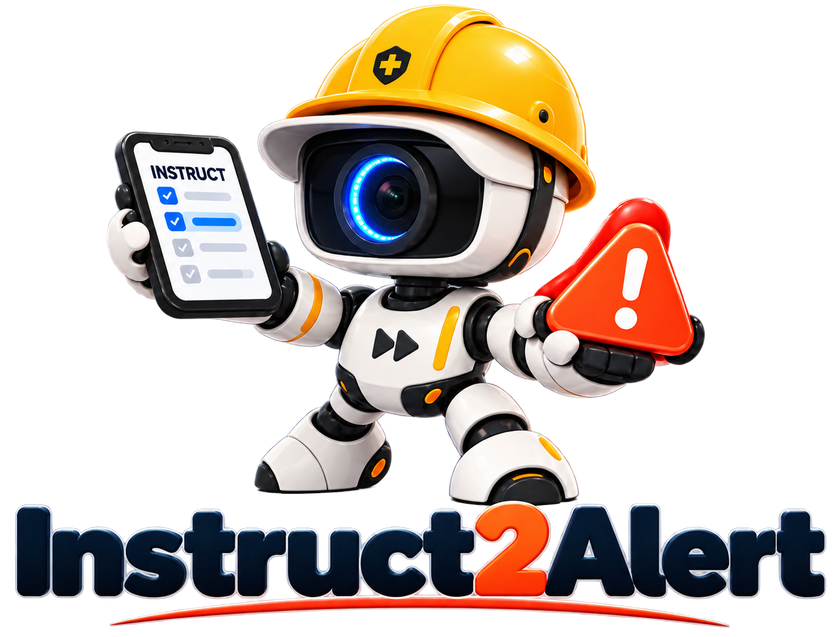

<p align="center">
  <picture>
    <source media="(prefers-color-scheme: dark)" srcset="docs/assets/logo_dark.png">
    
  </picture>
</p>

<h3 align="center">Decoupling Visual Verification from Temporal Alert Control<br>in Video Safety Monitoring</h3>

<p align="center">
  Yoel Shin, Byung-In Kim, Sangwoo Mo<br>
  POSTECH
</p>

<p align="center">
  <!-- <a href="TBD"></a> -->
  <a href="LICENSE"></a>
  <a href="data/LICENSE"></a>
  
</p>

<p align="center">
  <a href="#abstract">Abstract</a> |
  <a href="#setup">Setup</a> |
  <a href="#data">Data</a> |
  <a href="#results">Results</a> |
  <a href="#citation">Citation</a>
</p>

---

## Abstract

Video safety monitoring requirements are often expressed as natural-language scenario queries that cannot be verified from individual frames. Such queries entangle target entities, spatial relations, frame-observable conditions, and duration constraints. Frame-level vision-language model (VLM) responses, by contrast, provide only local and unstable evidence. We find that resolving the visual side of this entanglement worsens the temporal side. A planned frame-verifiable prompt improves coverage, but it also sharply increases spurious intervals. Intermittent negative responses within genuine events fragment the alerts that do fire. Better prompting alone therefore cannot produce reliable alerts.

We propose **Instruct2Alert**, an executable instruction-to-alert workflow that decouples these concerns. A planner compiles each query into a specification of targets, frame-verifiable predicates, grounding modules, and temporal parameters. A grounded verifier executes only the specification's visual portion. A temporal controller then applies the instruction-derived activation threshold and a fixed clearing tolerance to form alert intervals. The workflow requires no task-specific VLM training.

We evaluate on a new 100-scenario interval-level benchmark from 85 videos. On this benchmark, planned prompting alone raises segment recall from 0.745 to 0.940 but nearly doubles false-alert episodes, from 125.7 to 221.3. The complete workflow holds segment recall at 0.934 while reducing false-alert episodes to 66.3, at the cost of longer detection delay.

## Setup

**Environments.** The VLM is served by vLLM in one conda environment, and the perception pipeline runs in another.

```bash
conda create -n vlm python=3.11 -y && conda run -n vlm pip install -r requirements/vlm.txt
conda create -n cv  python=3.10 -y
conda run -n cv pip install torch==2.4.0 torchvision==0.19.0 --index-url https://download.pytorch.org/whl/cu121
conda run -n cv pip install -r requirements/cv.txt
```

**Models.** Download [Qwen3-VL-8B-Instruct](https://huggingface.co/Qwen/Qwen3-VL-8B-Instruct) locally. The perception models (YOLO11, OmDet-Turbo, Depth-Anything-V2-Small) are fetched automatically on first use.

**Run.**

```bash
VLM_MODEL_PATH=/path/to/Qwen3-VL-8B-Instruct \
  ./run_dual_env.sh --run-root data/main_runs/run --internal-variants
```

`--internal-variants` also runs the ablation variants (Direct Prompt, Workflow Verify, Workflow + Onset).

**Evaluate.** A finished run writes `results/summary.csv` (the columns of the Results table) and `results/per_scenario.csv`. To recompute them from a saved run:

```bash
python scripts/evaluate.py --run-root data/main_runs/run
```

## Data

| | |
|---|---|
| Scenarios | 100: 50 **Event** (instantaneous) and 50 **State** (duration-conditioned) |
| Videos | 85, from UCF-Crime, AI-Hub CCTV, YouTube, iSafetyBench, NWPU Campus, WEDA-FALL |
| Domains | Public 55, Industrial 28, Traffic 17 |
| Annotation | Alert intervals per scenario, with inter-annotator agreement reported in the paper's supplementary material |
| Files | [`data/datasets/safety_vlm_dataset.xlsx`](data/datasets/safety_vlm_dataset.xlsx), [`data/video_sources.csv`](data/video_sources.csv) (YouTube URLs) |

The videos are not redistributed. Obtain them from their original sources ([`data/README.md`](data/README.md)) and place them in `data/input_video/` as `<Video_name>.mp4`. Some clips were trimmed or edited for the benchmark. The editing details needed to recreate them from the original videos are available on request from **yoelshin@postech.ac.kr**.

## Results

**Main-run ablation** (Qwen3-VL-8B).

| <sub>Method</sub> | <sub>P ↑</sub> | <sub>R ↑</sub> | <sub>F1 ↑</sub> | <sub>Acc ↑</sub> | <sub>FA Ep. ↓</sub> | <sub>Macro FPR ↓</sub> | <sub>SegRec ↑</sub> | <sub>R@tIoU0.3 ↑</sub> | <sub>TTD P90 (s) ↓</sub> |
|---|---|---|---|---|---|---|---|---|---|
| <sub>Direct Prompt</sub> | <sub>0.558</sub> | <sub>0.503</sub> | <sub>0.462</sub> | <sub>0.774</sub> | <sub>125.7</sub> | <sub>0.116</sub> | <sub>0.745</sub> | <sub>0.462</sub> | <sub>1.834</sub> |
| <sub>Workflow Verify</sub> | <sub>0.619</sub> | <sub>0.818</sub> | <sub>0.652</sub> | <sub>0.791</sub> | <sub>221.3</sub> | <sub>0.278</sub> | <sub>0.940</sub> | <sub>0.736</sub> | <sub>0.333</sub> |
| <sub>Workflow + Onset</sub> | <sub>0.665</sub> | <sub>0.734</sub> | <sub>0.636</sub> | <sub>0.832</sub> | <sub>103.0</sub> | <sub>0.147</sub> | <sub>0.881</sub> | <sub>0.682</sub> | <sub>1.447</sub> |
| <sub>Grounded Verify</sub> | <sub>0.670</sub> | <sub>0.799</sub> | <sub>0.676</sub> | <sub>0.810</sub> | <sub>194.0</sub> | <sub>0.225</sub> | <sub>0.959</sub> | <sub>0.739</sub> | <sub>0.435</sub> |
| <sub><b>Full (Ours)</b></sub> | <sub><b>0.758</b></sub> | <sub>0.775</sub> | <sub><b>0.712</b></sub> | <sub><b>0.867</b></sub> | <sub><b>66.3</b></sub> | <sub><b>0.102</b></sub> | <sub>0.934</sub> | <sub><b>0.764</b></sub> | <sub>2.395</sub> |

## Citation

```bibtex
@inproceedings{shin2027instruct2alert,
  title     = {Instruct2Alert: Decoupling Visual Verification from Temporal Alert Control in Video Safety Monitoring},
  author    = {Shin, Yoel and Kim, Byung-In and Mo, Sangwoo},
  booktitle = {Proceedings of the IEEE/CVF Winter Conference on Applications of Computer Vision (WACV)},
  year      = {2027}
}
```

## License

- **Code**: [AGPL-3.0](LICENSE), matching the Ultralytics YOLO11 components it uses.
- **Benchmark annotations**: [CC BY-NC 4.0](data/LICENSE), non-commercial use with attribution.
- **Videos** are not included and remain under the terms of their original sources ([`data/README.md`](data/README.md)).

<details>
<summary>Third-party models and libraries</summary>

| Component | Used for | License |
|---|---|---|
| [Qwen3-VL-8B-Instruct](https://huggingface.co/Qwen/Qwen3-VL-8B-Instruct) | planner and verifier | Apache-2.0 |
| [Ultralytics YOLO11](https://github.com/ultralytics/ultralytics) (`yolo11l`, `yolo11l-pose`) | person detection, pose | AGPL-3.0 |
| [OmDet-Turbo](https://huggingface.co/omlab/omdet-turbo-swin-tiny-hf) | open-vocabulary detection | Apache-2.0 |
| [Depth-Anything-V2-Small](https://huggingface.co/depth-anything/Depth-Anything-V2-Small-hf) | relative depth | Apache-2.0 |
| [vLLM](https://github.com/vllm-project/vllm) | VLM serving | Apache-2.0 |

</details>
